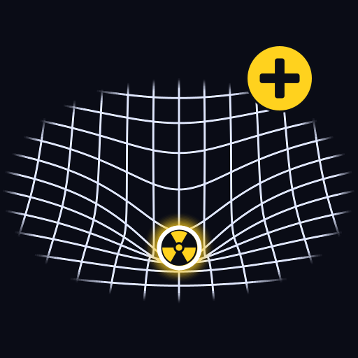

<p align="center"></p>

<h1 align="center">NTM Additions</h1>

<p align="center">A quality-of-life add-on for <a href="https://github.com/Warfactory-Official/NTM-Continuum">NTM - Continuum</a> (HBM's Nuclear Tech Mod): Curios slots for detectors and gas masks, a Lung Tester, and visor and Geiger fixes.<br>Minecraft 1.21.1 · NeoForge · NTM - Continuum · Curios</p>

---

## Features

- **Curios slots** for the **Geiger counter / dosimeter**, the **pollution detector** and **gas masks**. Items in these slots work like they do in your hands or on your head, without using hotbar or inventory space.
  - A mask in the slot **adds** to your helmet's protection. Its filter wears down normally and is only used when the helmet isn't filtering already.
  - Armor with a built-in Geiger counter doesn't click twice.
- **Lung Tester**, ported from HBM Extended's Lung Diagnostic:
  - scans your lungs, or another player's or a mob's;
  - shows asbestos and coal lung health, total health and an MKU test;
  - has its own page in NTM's F1 manual.
- **Visor overlay options**: hide NTM's helmet / gas mask visor overlay, or show it for the mask in the Curios slot.
- **Visor overlay fix**: Jade and other HUD elements no longer disappear behind the overlay.
- **Mute Geiger counters**:
  - one option for carried items, one for placed blocks;
  - quick buttons in *Music & Sounds*, and an optional key;
  - client-side, so every player chooses for themselves.
- **Languages**: English and Brazilian Portuguese.

Options are in *Mods → NTM Additions → Config* or `config/ntmadditions-client.toml`. The slots use the item tags `curios:geiger`, `curios:pollution` and `curios:mask`, so datapacks can add more items.

## Requirements

- **NTM - Continuum** and **Golem Core**
- **Curios API** 9.x

Install on **both server and client**.

## Building

Standard NeoForge [ModDevGradle](https://github.com/neoforged/ModDevGradle) project. Requires JDK 21.

```sh
./gradlew build        # jar in build/libs/
```

Dependencies come from CurseForge through [CurseMaven](https://www.cursemaven.com/). GitHub Actions builds every push, and pushing a tag `v<mod_version>` publishes a release.

## License

[MIT](LICENSE). Unofficial add-on, not affiliated with the NTM - Continuum team. Thanks to HbMinecraft and the HBM's Nuclear Tech Mod team, Warfactory (NTM - Continuum), Alcater (HBM Extended) and TheIllusiveC4 (Curios).
